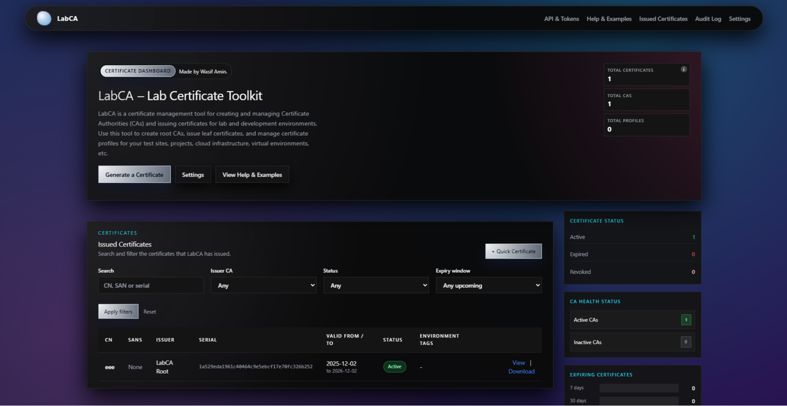
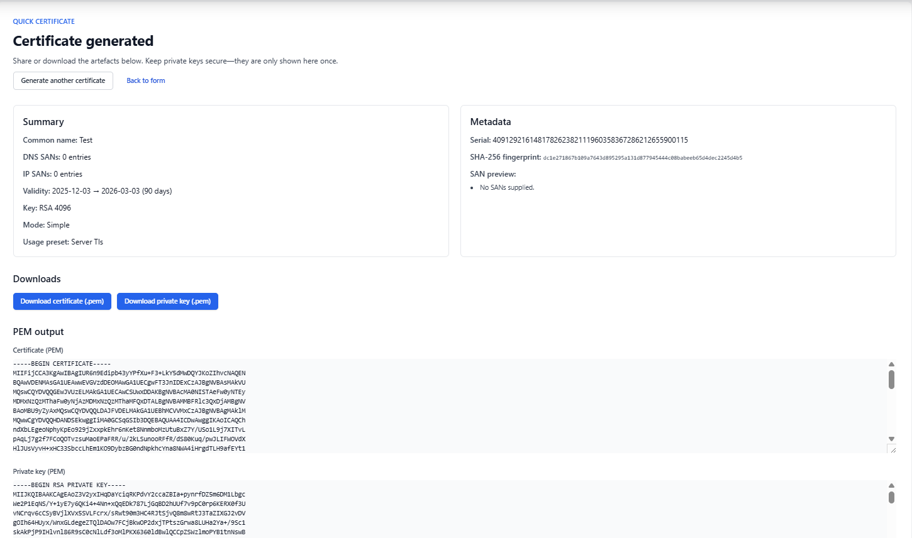
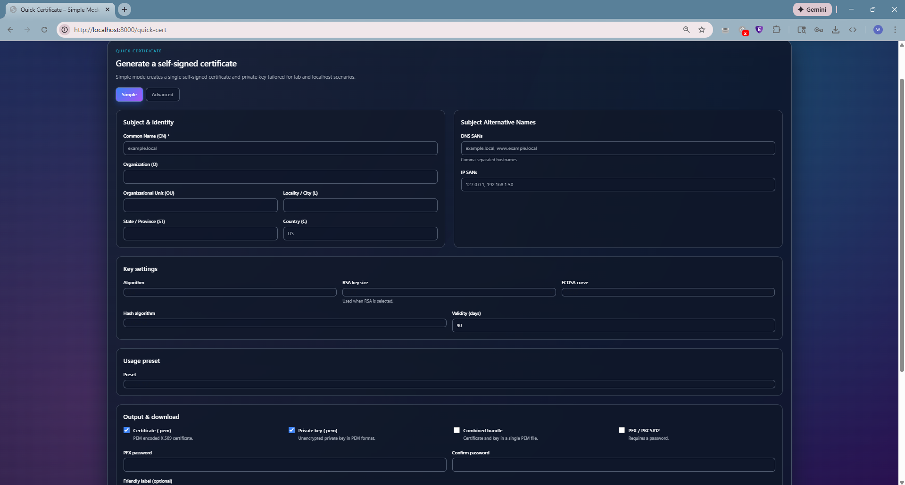

# LabCA – Internal Certificate & CA Lab Toolkit


LabCA is a FastAPI-based web console that lets you stand up a lightweight certificate authority, issue test certificates, and explore PKI workflows in a self-contained environment. It is designed for lab, demo, and portfolio scenarios rather than hardened production deployments.


<div style="display: flex; gap: 10px;">
  
  
</div>


## Feature highlights

- **Setup wizard** for creating or importing a root/intermediate CA.
- **Quick certificate** generator (simple + advanced) for instant PEM/PFX output.
- **Full CA issuance** with subject/usage controls, persistence, and revocation tracking.
- **Profiles/templates** to store default issuance policies.
- **Token-protected REST API** for certificate issuance and retrieval.
- **Notifications & audit log** to model reminders and capture key events.
- **Security controls** such as key-download policies and centralized configuration.

## Architecture overview

- **Stack:** FastAPI, Starlette, SQLAlchemy, Alembic, Jinja2 + HTMX, Tailwind, SQLite.
- **Structure:**  
  - `app/models/` – SQLAlchemy ORM models (CA, certificates, profiles, audit, notifications).  
  - `app/routes/` – FastAPI routers for UI + API.  
  - `app/services/` – Business logic (crypto, issuance, notifications, audit).  
  - `app/templates/` – Jinja2 templates with Tailwind styling.  
  - `alembic/` – Database migrations.  
  - `tests/` – Pytest suites for core flows.

## Configuration

Environment variables are managed through `app/config.py` (`pydantic-settings`). Copy `.env.example` to `.env` and update secrets:

```
APP_NAME=LabCA
ENV=dev
DATABASE_URL=sqlite:///./labca.db
SECRET_KEY=CHANGE_THIS_TO_A_SECURE_RANDOM_VALUE
LOG_LEVEL=INFO
ENABLE_API_DOCS=true
API_TOKEN_CREATION_SECRET=choose-a-secret
```

- `ENABLE_API_DOCS=false` + `ENV=prod` hides `/docs` and `/redoc`.
- `API_TOKEN_CREATION_SECRET` must be set to mint API tokens via `/api`.

## Getting started (local)

Requirements: Python 3.11+, SQLite (built-in), OpenSSL libs (installed by default on Linux/macOS/WSL).

### Installation Steps

1. **Clone the repository:**
```bash
git clone https://github.com/yourname/labca.git
cd labca
```

2. **Create and activate virtual environment:**
```bash
# Linux/macOS/WSL:
python -m venv .venv
source .venv/bin/activate

# Windows (PowerShell):
python -m venv .venv
.venv\Scripts\activate

# Windows (CMD):
python -m venv .venv
.venv\Scripts\activate.bat
```

3. **Install dependencies:**
```bash
pip install -r requirements.txt
```

4. **Configure environment (optional):**
   - The application will work with default settings, but you can create a `.env` file for customization.
   - Create a `.env` file in the project root with the following variables (or copy from `.env.example` if it exists):
```bash
# Linux/macOS/WSL:
cp .env.example .env  # if .env.example exists

# Windows (PowerShell):
Copy-Item .env.example .env  # if .env.example exists

# Or create .env manually with:
APP_NAME=LabCA
ENV=dev
DATABASE_URL=sqlite:///./labca.db
SECRET_KEY=CHANGE_THIS_TO_A_SECURE_RANDOM_VALUE
LOG_LEVEL=INFO
ENABLE_API_DOCS=true
API_TOKEN_CREATION_SECRET=choose-a-secret
```

5. **Run database migrations:**
```bash
python -m alembic upgrade head
```

6. **Start the server:**
```bash
python -m uvicorn app.main:app --reload
```

Or alternatively:
```bash
uvicorn app.main:app --reload
```

Visit `http://localhost:8000/` for the UI and `http://localhost:8000/health` for the heartbeat probe.

### Docker & Compose

Build the container:

```bash
docker build -t labca:latest .
```

Run with Compose (hot reload + volume mount for dev):

```bash
docker compose up --build
# Apply migrations inside the container
docker compose run --rm labca python -m alembic upgrade head
```

The container defaults to `ENV=prod` and hides API docs unless you set `ENABLE_API_DOCS=true`.

## Usage guide

1. **Run the Setup Wizard** (`/setup`) to create or import a root CA. The CA appears on `/cas`.
2. **Issue a certificate** from `/cas/{id}/issue` or use `/quick-cert` for ad-hoc leaf certs.
3. **Store and view** issued certs on `/certificates`, download PEM/key/chain exports, and revoke as needed.
4. **Create profiles** (`/profiles`) to templatize subjects, key sizes, and outputs for recurring workloads.
5. **Automate via API:**  
   - Visit `/api` to create a token (requires `API_TOKEN_CREATION_SECRET`).  
   - Issue certs with `curl` against `/api/v1/certificates`.  
   - Fetch PEMs via `/api/v1/certificates/{id}`.
6. **Review notifications & audit:**  
   - `/notifications` configures reminder windows (30/7/1 days by default).  
   - `/audit` shows structured log entries for CA creation, issuance, settings changes, API calls, etc.

Additional screenshots to capture in `docs/`:

- `docs/home.png` – landing dashboard.  
- `docs/ca_list.png` – CA overview.  
- `docs/issue_cert.png` – CA issuance form.

## Development workflow & quality gates

- Format & sort imports: `make format`
- Lint: `make lint`
- Tests: `make test`
- Run all: `make all`

CI readiness: `.github/workflows/ci.yml` installs dependencies, runs lint, and executes pytest. You can reuse it on GitHub Actions or adapt to other CI platforms.

## Deployment notes & security posture

- **Scope:** LabCA is for labs/demos. Keys are stored on disk without HSM or envelope encryption.
- **Authentication:** There is no user auth yet; restrict network access or front it with a VPN/sso proxy if sharing.
- **Secrets:** Never commit `.env`. Use the `.env.example` template and populate secrets securely.
- **API docs:** Disable Swagger/ReDoc in prod via `ENABLE_API_DOCS=false`.
- **Private key downloads:** Governed by the `allow_key_download_policy` setting; routes enforce the policy before exposing PEMs.
- **HTTPS:** Terminate TLS using a reverse proxy (Nginx, Caddy, Traefik). LabCA itself does not manage server certificates.
- **Future hardening ideas:** SSO/OIDC auth, CRL/OCSP publishing, encrypted key storage, audit log exports, background workers for notifications.

## Documentation & demos

- Walk through [`docs/DEMO_CHECKLIST.md`](docs/DEMO_CHECKLIST.md) before showcasing the app.
- Replace the placeholder screenshots in `docs/` with real captures for your portfolio.

## Roadmap ideas

- SSO authentication + granular RBAC.
- Automated CRL generation and OCSP responders.
- Scheduler-backed notification delivery (email/webhook integrations).
- Pluggable storage backends (PostgreSQL, MySQL).
- Advanced policy objects (CABF profiles, ACME integrations).

## License & attribution

This repository is a personal portfolio project. Feel free to reference or extend it for your own learning; validate security requirements before using it beyond lab scopes.
